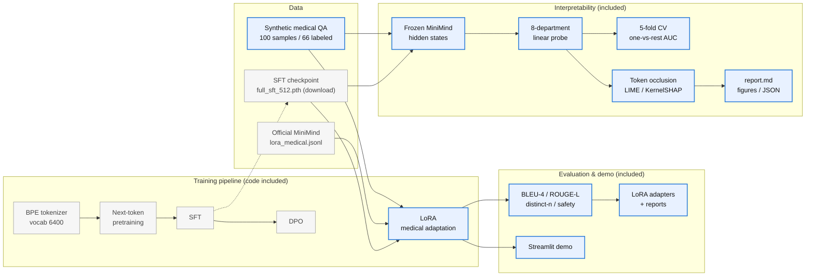
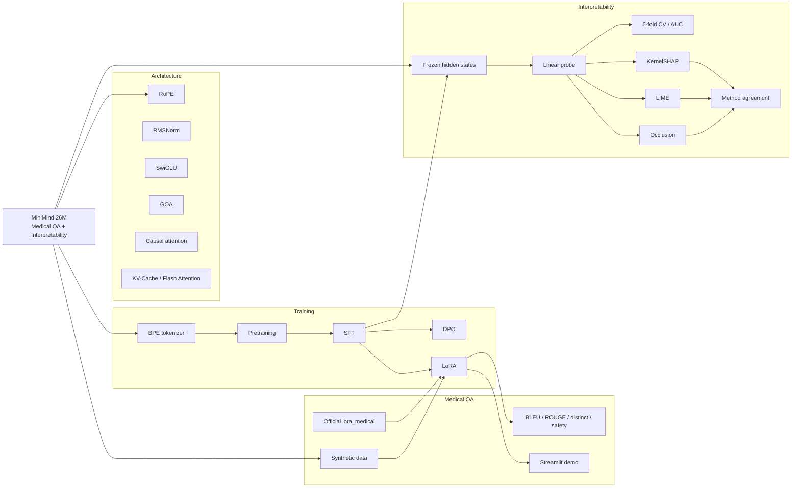

# MiniMind Medical QA + Interpretability (26M)

[](README.md)
[](README.zh-CN.md)

**This is a minimal, runnable release** of a **26M-parameter MiniMind** project focused on Chinese medical question answering and interpretability.

This repository is based on the open-source [MiniMind](https://github.com/jingyaogong/minimind) project (Apache-2.0). It contains the code needed to verify the model, the training pipeline, the medical LoRA experiment, and the interpretability analysis. **Large base weights and datasets are not included**; download instructions are below.

> **Minimal runnable version.** This repository is intentionally a subset of the full project:
> it contains the code, medical LoRA adapters and interpretability results needed to verify the
> pipeline end-to-end. It does **not** contain the 56MB base checkpoint, the large training
> datasets, or the full pretrain/SFT/DPO checkpoints and logs. See
> [Scope and limitations](#scope-and-limitations) for the exact boundary.

## Project map

### Pipeline



**Legend:** blue = included or reproducible in this minimal release; grey = code path or external download, not redistributed.

### Knowledge map



## What this minimal version includes

- **26M decoder-only Transformer**: RoPE, RMSNorm, SwiGLU, grouped-query attention (GQA), causal self-attention, KV-Cache and Flash Attention.
- **Training pipeline code**: tokenization, next-token pretraining, SFT, DPO and LoRA trainers.
- **Medical QA LoRA adapters** (`0.131M` trainable parameters, about `0.50%`) plus evaluation reports.
- **Interpretability toolkit**: frozen MiniMind hidden states → 8-department linear probe → 5-fold cross-validation + one-vs-rest AUC → token occlusion + LIME + KernelSHAP, with out-of-fold explanations.
- **Synthetic sample medical data** and reproducible reports.

### What this minimal version does not include

- The 56MB base checkpoint `full_sft_512.pth` — download it with the command in Quick start.
- Large datasets (`pretrain_hq.jsonl`, `sft_mini_512.jsonl`, `dpo.jsonl`, `lora_medical.jsonl`) — download from the MiniMind dataset links.
- Full pretrain/SFT/DPO checkpoints and training logs; the released results use the official SFT base plus the included medical LoRA adapters.
- A 64M checkpoint, a 3B-token pretraining checkpoint, or a 10K+ instruction SFT checkpoint — the code supports these runs, but they are not part of this minimal release.

## Results

### Model

- **25.83M parameters** with the default configuration (`hidden_size=512`, `num_hidden_layers=8`, `vocab_size=6400`).

### Medical QA LoRA

| Run | Training data | BLEU | ROUGE-L | Eval samples |
|---|---|---:|---:|---:|
| Base (`full_sft_512.pth`) | — | 0.0248 | 0.1243 | 20 |
| Medical LoRA (official) | MiniMind `lora_medical.jsonl` | 0.0243 | **0.1283** | 20 |
| Base (`full_sft_512.pth`) | — | 0.0267 | 0.1239 | 20 |
| Medical LoRA (sample-100) | 80 synthetic questions | **0.0288** | **0.1460** | 20 |

The evaluation set is small (20 questions), so treat these numbers as a smoke test rather than a benchmark. The included reports are in [`evidence/`](evidence/).

### Interpretability

- 66 labeled synthetic questions across 8 departments.
- **8-way out-of-fold accuracy: 0.636** (random chance: 0.125); macro-F1: **0.642**.
- One-vs-rest AUC: **0.729 – 0.961** depending on the department.
- Top-1 cues are stable across occlusion, LIME and KernelSHAP:
  - Pediatrics: `宝宝` (occlusion +0.952, LIME +0.884, SHAP +0.922).
  - OB/GYN: `宫颈` (occlusion +0.887, LIME +0.343, SHAP +0.298).
- Secondary-token attributions can disagree between methods; this is documented in the report rather than hidden.

Full report: [`applications/interpretability/results/report.md`](applications/interpretability/results/report.md).

## Quick start

This is the complete verification path for the minimal release: install dependencies, download the base checkpoint, verify the model/LoRA, then run the interpretability analysis.

### 1. Install dependencies

```bash
python -m pip install -r requirements.txt
python -m pip install -r applications/interpretability/requirements.txt
```

### 2. Download the base checkpoint (not included, ~56MB)

```bash
mkdir -p out
curl -L -o out/full_sft_512.pth \
  https://www.modelscope.cn/models/gongjy/MiniMind2-PyTorch/resolve/master/full_sft_512.pth
```

### 3. Verify the setup

```bash
python scripts/verify_setup.py --weight_path out/full_sft_512.pth
```

Expected output includes:

```text
[ok] tokenizer loaded: vocab_size=6400
[ok] model instantiated: 25.83M parameters
[ok] forward pass: logits=(1, 8, 6400)
[ok] loaded base checkpoint: full_sft_512.pth
[ok] loaded LoRA adapter: lora_medical_official_512.pth
[ok] LoRA parameters: 0.131M
[done] minimal setup is runnable
```

### 4. Run the interpretability analysis

```bash
python applications/interpretability/run_all.py
```

This writes figures, JSON metrics and `report.md` to `applications/interpretability/results/`. On a laptop CPU the run takes about 15–20 seconds.

## Repository layout

```text
model/                          # MiniMind architecture + LoRA implementation
dataset/                        # Pretrain / SFT / DPO dataset classes
trainer/                        # Pretrain, SFT, DPO and LoRA trainers
scripts/
  ├── train_tokenizer.py        # BPE tokenizer training (vocab 6400)
  └── verify_setup.py           # Minimal runnable verification
applications/
  ├── medical_qa/               # Data prep, LoRA experiment, evaluation, Streamlit demo
  └── interpretability/         # Probe + occlusion/LIME/KernelSHAP + generated reports
evidence/                       # Included LoRA adapters + evaluation JSON/Markdown
```

## Training pipeline (optional)

The trainers are included for reproducibility. Download the datasets from
[HuggingFace](https://huggingface.co/datasets/jingyaogong/minimind_dataset) or
[ModelScope](https://www.modelscope.cn/datasets/gongjy/minimind_dataset) and place them under `dataset/`:

| File | Size | Purpose |
|---|---:|---|
| `pretrain_hq.jsonl` | ~1.6GB | next-token pretraining |
| `sft_mini_512.jsonl` | ~1.2GB | SFT instructions |
| `dpo.jsonl` | ~55MB | DPO preference pairs |
| `lora_medical.jsonl` | ~34MB | medical LoRA |

Then run from the `trainer/` directory:

```bash
cd trainer

# Next-token pretraining (multi-epoch; a 3B-token run is supported but not included)
python train_pretrain.py \
  --data_path ../dataset/pretrain_hq.jsonl \
  --epochs 10 --hidden_size 512 --num_hidden_layers 8 --save_dir ../out

# Supervised fine-tuning
python train_full_sft.py \
  --data_path ../dataset/sft_mini_512.jsonl \
  --epochs 2 --hidden_size 512 --num_hidden_layers 8 \
  --from_weight pretrain --save_dir ../out

# DPO
python train_dpo.py \
  --data_path ../dataset/dpo.jsonl \
  --epochs 1 --hidden_size 512 --num_hidden_layers 8 \
  --from_weight full_sft --save_dir ../out

# Medical LoRA
python train_lora.py \
  --lora_name lora_medical \
  --data_path ../dataset/lora_medical.jsonl \
  --epochs 3 --hidden_size 512 --num_hidden_layers 8 \
  --from_weight full_sft --save_dir ../out
```

> The pipeline code is included; the released results in this repository use the official
> `full_sft_512.pth` base checkpoint plus the included medical LoRA adapters, and the
> interpretability probe. A full 3B-token pretraining run is supported by the code but
> its checkpoint is not included in this repository.

## Data provenance

- `applications/medical_qa/data/sample_medical_qa.jsonl` is **synthetic**: 100 QA pairs generated by
  `generate_sample_data.py` (66 with department labels across 8 departments). It is for development
  and pipeline validation only, not real clinical data.
- Medical LoRA training used the official MiniMind `lora_medical.jsonl` (~34MB), which is **not**
  redistributed here. Download it from the MiniMind dataset links above.
- No patient-identifiable data is included.

## Scope and limitations

- This is a **26M** model. The repository does not include a 64M checkpoint. If you want a ~64M
  variant with the same code, `--hidden_size 832 --num_hidden_layers 8` gives **63.91M**
  parameters and the forward pass works; it must be pretrained from scratch.
- No 3B-token pretraining checkpoint or training log is included. The trainer supports
  multi-epoch pretraining, but that run is not part of this release.
- No full SFT or DPO checkpoint is included; the base `full_sft_512.pth` is downloaded from the
  official MiniMind release.
- The interpretability analysis explains a **linear probe on frozen MiniMind representations**,
  not the generative language head directly.
- The medical evaluation set has only 20 questions. Treat the reported metrics as a smoke test.
- The probe dataset is synthetic; results are useful for validating the interpretability
  pipeline, not for clinical claims.

## Attribution & license

This repository is based on [MiniMind](https://github.com/jingyaogong/minimind) by
Jingyao Gong, licensed under the Apache License 2.0. The original [`LICENSE`](LICENSE) is included.
The medical QA application, interpretability module, included LoRA adapters and generated
results are additions in this repository and are released under the same license.
