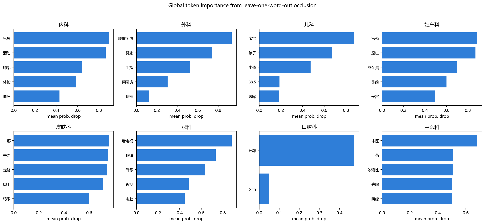

# MiniMind 医疗问答可解释性分析报告

## 1. 实验设置

- 模型：MiniMind2-Small，参数量 **25.83M**，权重 `full_sft_512.pth`
- 数据：`sample_medical_qa.jsonl`，8 个科室共 **66** 条问题
- 表征：冻结模型最后一层 hidden state，按 attention mask 做 mean pooling（512 维）；初测中 mean pooling 明显优于 last-token pooling
- 探针：StandardScaler + LogisticRegression（C=1.0，class_weight='balanced'）
- 评测：5-fold StratifiedKFold；随机猜测准确率 12.5%

> 说明：这里解释的是 **基于 MiniMind 隐状态的科室分类探针**，不是生成式语言头本身。这样做的好处是预测目标明确、可复现；局限见第 6 节。

## 2. 探针分类指标

- 8 分类 out-of-fold 准确率：**0.636**（随机猜测 0.125）
- Macro-F1：**0.642**

| 科室 | 样本数 | Precision | Recall | F1 | 单类 one-vs-rest AUC |
|---|---:|---:|---:|---:|---:|
| 内科 | 13 | 0.471 | 0.615 | 0.533 | 0.830 |
| 外科 | 9 | 0.667 | 0.667 | 0.667 | 0.729 |
| 儿科 | 8 | 0.636 | 0.875 | 0.737 | 0.944 |
| 妇产科 | 7 | 0.857 | 0.857 | 0.857 | 0.961 |
| 皮肤科 | 7 | 0.400 | 0.286 | 0.333 | 0.777 |
| 眼科 | 7 | 0.667 | 0.571 | 0.615 | 0.867 |
| 口腔科 | 7 | 1.000 | 0.571 | 0.727 | 0.903 |
| 中医科 | 8 | 0.714 | 0.625 | 0.667 | 0.922 |

混淆矩阵见 [probe_confusion_matrix.png](probe_confusion_matrix.png)，单类 AUC 见 [probe_auc.png](probe_auc.png)。

## 3. 全局特征重要性（token occlusion）

对每个 **out-of-fold 预测正确** 的样本，逐个删除问题中的一个词，观察目标科室概率下降多少；按科室聚合平均下降幅度，得到支持该科室的关键词。

| 科室 | Top positive tokens（mean probability drop；n=出现次数） |
|---|---|
| 内科 | 气短 (+0.894, n=1), 活动 (+0.864, n=1), 肺部 (+0.641, n=1), 体检 (+0.586, n=1), 血压 (+0.430, n=2), 肺炎 (+0.309, n=1) |
| 外科 | 腰椎间盘 (+0.931, n=1), 腱鞘 (+0.738, n=1), 手指 (+0.525, n=1), 阑尾炎 (+0.305, n=1), 痔疮 (+0.127, n=1), 膝盖 (+0.044, n=1) |
| 儿科 | 宝宝 (+0.878, n=2), 孩子 (+0.673, n=3), 小孩 (+0.473, n=2), 38.5 (+0.186, n=1), 咳嗽 (+0.184, n=1), 反复 (+0.183, n=1) |
| 妇产科 | 宫颈 (+0.887, n=1), 糜烂 (+0.871, n=1), 宫颈癌 (+0.701, n=1), 孕前 (+0.601, n=1), 子宫 (+0.493, n=1), 怀孕 (+0.367, n=3) |
| 皮肤科 | 疼 (+0.756, n=1), 去除 (+0.750, n=1), 走路 (+0.745, n=1), 脚上 (+0.710, n=1), 鸡眼 (+0.599, n=1), 皮肤 (+0.183, n=1) |
| 眼科 | 看电视 (+0.881, n=1), 眼睛 (+0.733, n=2), 眯眼 (+0.634, n=1), 近视 (+0.484, n=2), 电脑 (+0.447, n=1), 歪头 (+0.321, n=1) |
| 口腔科 | 牙龈 (+0.474, n=1), 牙齿 (+0.049, n=2) |
| 中医科 | 中医 (+0.682, n=3), 西药 (+0.507, n=1), 依赖性 (+0.506, n=1), 失眠 (+0.501, n=1), 阴虚 (+0.501, n=1), 气虚 (+0.498, n=1) |

> 很多词在 66 条样本中只出现 1 次（n=1），因此上表是探索性聚合，不是稳定的全局重要性排名；单样本解释以第 4 节为准。负向 token 仍保存在 `global_occlusion.json` 中。



## 4. 单样本解释

每个样本都是 **out-of-fold** 预测（使用未见过该样本的 fold 模型），因此解释的是模型对未见样本的真实预测。

| 科室 | 问题 | P(科室) | Occlusion Top words | LIME Top words | SHAP Top words |
|---|---|---:|---|---|---|
| 儿科 | 宝宝添加辅食后总是拉肚子，是过敏吗？ | 0.956 | 宝宝 (+0.952), 辅食 (+0.005), 过敏 (-0.029), 拉肚子 (-0.033), 添加 (-0.041) | 宝宝 (+0.884), 辅食 (+0.099), 添加 (+0.036), 拉肚子 (+0.030) | 宝宝 (+0.922), 辅食 (+0.071), 拉肚子 (+0.022), 添加 (+0.021), 过敏 (-0.001) |
| 妇产科 | 宫颈糜烂需要治疗吗？会变成宫颈癌吗？ | 0.909 | 宫颈 (+0.887), 糜烂 (+0.871), 宫颈癌 (+0.701) | 宫颈 (+0.343), 宫颈癌 (+0.100), 糜烂 (-0.167) | 宫颈 (+0.298), 宫颈癌 (+0.104), 糜烂 (-0.173) |
| 皮肤科 | 脚上长了鸡眼，走路很疼，怎么去除？ | 0.766 | 疼 (+0.756), 去除 (+0.750), 走路 (+0.745), 脚上 (+0.710), 鸡眼 (+0.599) | 疼 (+0.065), 走路 (+0.053), 脚上 (+0.031), 去除 (+0.019), 鸡眼 (-0.093) | 走路 (+0.210), 疼 (+0.026), 去除 (+0.025), 脚上 (-0.036), 鸡眼 (-0.096) |

### 儿科：宝宝添加辅食后总是拉肚子，是过敏吗？

- 预测概率：0.956
- LIME：见 [lime_43_Pediatrics.png](lime_43_Pediatrics.png)，交互式 HTML 见 [lime_43_Pediatrics.html](lime_43_Pediatrics.html)
- SHAP：见 [shap_43_Pediatrics.png](shap_43_Pediatrics.png)

### 妇产科：宫颈糜烂需要治疗吗？会变成宫颈癌吗？

- 预测概率：0.909
- LIME：见 [lime_18_OB_GYN.png](lime_18_OB_GYN.png)，交互式 HTML 见 [lime_18_OB_GYN.html](lime_18_OB_GYN.html)
- SHAP：见 [shap_18_OB_GYN.png](shap_18_OB_GYN.png)

### 皮肤科：脚上长了鸡眼，走路很疼，怎么去除？

- 预测概率：0.766
- LIME：见 [lime_29_Dermatology.png](lime_29_Dermatology.png)，交互式 HTML 见 [lime_29_Dermatology.html](lime_29_Dermatology.html)
- SHAP：见 [shap_29_Dermatology.png](shap_29_Dermatology.png)

## 5. 方法对比

| 方法 | 粒度 | 主要作用 | 实现 |
|---|---|---|---|
| Token occlusion | 词 | 直接衡量删除某词后目标概率的变化，直观但忽略词间交互 | 逐词删除后重新前向 |
| LIME | 词 | 局部线性近似，给出支持/反对预测的词权重 | `lime.lime_text.LimeTextExplainer` |
| SHAP (KernelSHAP) | 词 | 基于 Shapley 值的加性归因，理论性质更好 | `shap.KernelExplainer` + 词存在性 mask |

### 一致性观察

- 在多数样本上，三种方法的 **top-1 词**一致（例如儿科的 `宝宝`、妇产科的 `宫颈`），说明这些词确实是探针最依赖的线索。
- 对次要词，occlusion 与 LIME/SHAP 可能给出不同符号：occlusion 衡量“删除该词”的边际效应，LIME/SHAP 衡量局部加性贡献，两者对词间交互的处理不同。
- 因此本报告以 **排名一致性** 为主结论，不把任何单一方法的符号当作因果效应。

## 6. 局限

1. 数据是项目内置的合成医疗问答（66 条有科室标签），规模小，指标波动大；结论只用于验证流程。
2. 解释对象是线性探针，不是生成式语言头。它回答的是“MiniMind 隐状态里哪些词支持科室判断”，不能直接等同于“模型生成答案时关注了什么”。
3. 词级扰动会破坏原始语序和语法，LIME/SHAP 的归因是相关性的近似。
4. 单类 one-vs-rest AUC 使用独立的二分类探针，和 8 分类探针不是同一个模型。

## 7. 复现

```bash
# 1) 生成示例数据（如果还没有 sample_medical_qa.jsonl）
python applications/medical_qa/data/generate_sample_data.py

# 2) 下载官方 26M SFT 权重到 out/full_sft_512.pth
curl -L -o out/full_sft_512.pth \
  https://www.modelscope.cn/models/gongjy/MiniMind2-PyTorch/resolve/master/full_sft_512.pth

# 3) 运行完整可解释性分析
python applications/interpretability/run_all.py
```

运行参数：`n_splits=5`, `C=1.0`, `lime_samples=500`, `shap_samples=300`, `seed=42`。
